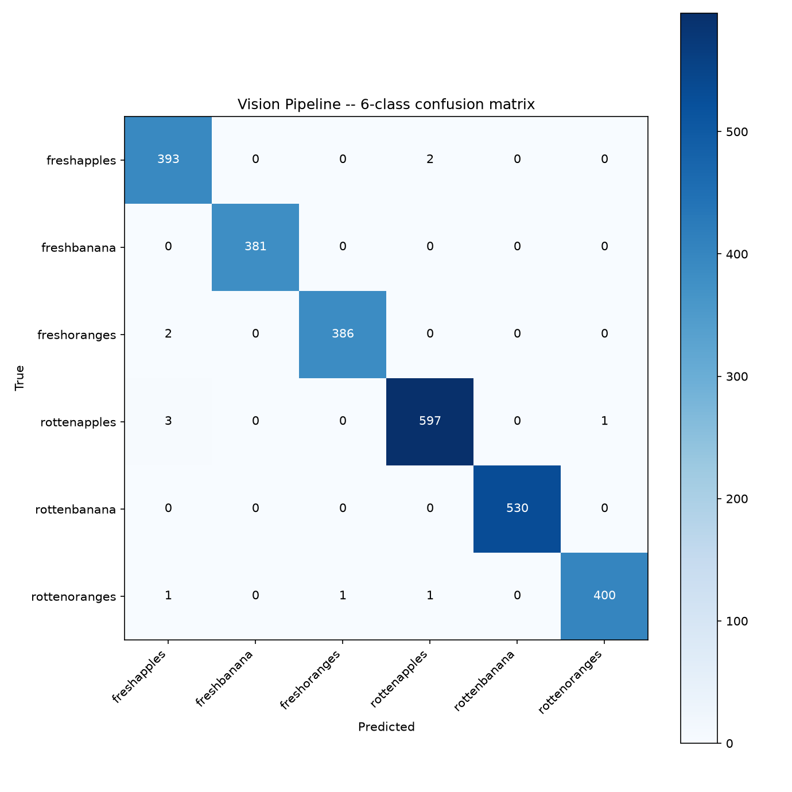
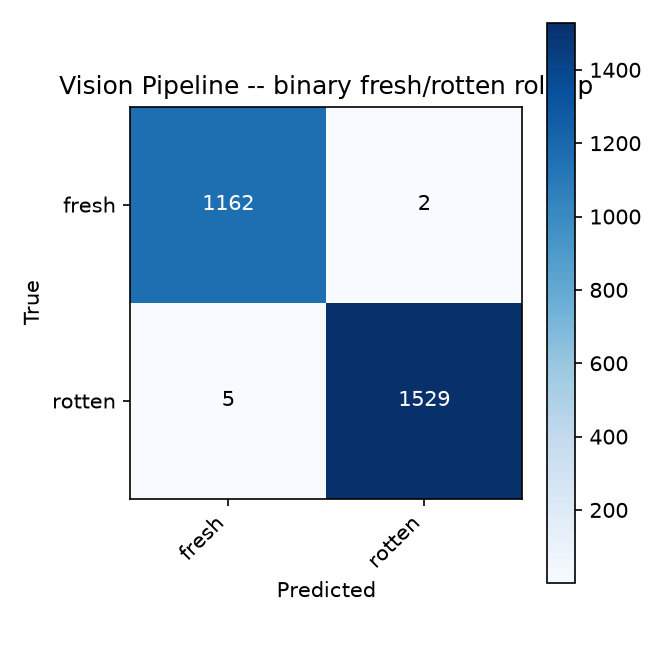

# Evaluation results

Generated by `scripts/evaluate.py` (issue #13: Evaluation metrics & report structure). `docs/report.md` embeds/links these rather than restating the numbers.

## Vision Pipeline

Evaluated against the held-out `data/raw/dataset/test/` split (2698 images).

- **Overall accuracy:** 0.9959
- **Macro precision:** 0.9958
- **Macro recall:** 0.9959
- **Macro F1:** 0.9959

### Per-class

| Class | Precision | Recall | F1 |
| --- | --- | --- | --- |
| freshapples | 0.9850 | 0.9949 | 0.9899 |
| freshbanana | 1.0000 | 1.0000 | 1.0000 |
| freshoranges | 0.9974 | 0.9948 | 0.9961 |
| rottenapples | 0.9950 | 0.9933 | 0.9942 |
| rottenbanana | 1.0000 | 1.0000 | 1.0000 |
| rottenoranges | 0.9975 | 0.9926 | 0.9950 |

### Confusion matrix

### Binary fresh/rotten roll-up

- **Accuracy:** 0.9974

| Class | Precision | Recall | F1 |
| --- | --- | --- | --- |
| fresh | 0.9957 | 0.9983 | 0.9970 |
| rotten | 0.9987 | 0.9967 | 0.9977 |

## Receipt Pipeline

**Pending.** No hand-labeled real-receipt set found at `data/real_receipts/labels.csv` yet (Phase 1's ~15-20 real-receipt collection, per issue #13, hasn't landed). Add hand-photographed receipts to `data/real_receipts/images/` and ground truth rows to `data/real_receipts/labels.csv` (see `scripts/evaluate.py`'s module docstring for the format), then rerun `python scripts/evaluate.py`.
